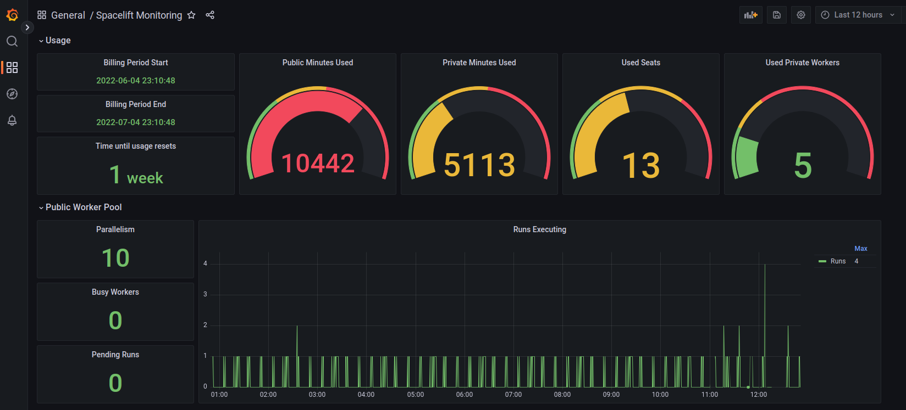

# Spacelift Prometheus Exporter

This repository contains a Prometheus exporter for exporting metrics from your Spacelift account.



## Quick Start

The Spacelift exporter is provided as a statically linked Go binary and a Docker container. You can
find the latest release [here](https://github.com/spacelift-io/prometheus-exporter/releases/latest).
The Docker container is available from our public container registry:
`public.ecr.aws/spacelift/promex`.

### Authentication

The exporter uses
[Spacelift API keys](https://docs.spacelift.io/integrations/api#spacelift-api-key-greater-than-token)
to authenticate, and also needs to know your Spacelift account API endpoint. Your API endpoint is in
the format `https://<account>.app.spacelift.io`, for example `https://my-account.app.spacelift.io`.

**NOTE:** on current Spacelift SaaS any API key works, provided it can read the root space (the
`usage` field requires it). Self-Hosted releases older than August 2026 restrict `publicWorkerPool`,
`usage` and `metrics` to non-machine keys; on such a release, run the exporter with an admin user's
key or with `--partial-scrapes`, which serves the private worker pool metrics and reports the
restricted collectors as unsupported (see below).

#### OIDC API keys with rotating secrets

If your API key is configured for OIDC (the key ID has the form `oidc::<issuer>::<key-id>`), the
"secret" is an OIDC JWT issued by your identity provider rather than a static string. Use
`--api-key-secret-file` (or `SPACELIFT_PROMEX_API_KEY_SECRET_FILE`) to point at the file that holds
the token. The file is re-read on every token refresh, so projected Kubernetes service-account
tokens that rotate on disk are picked up automatically without restarting the exporter.

### Running via the Binary

Download the exporter binary from our
[releases](https://github.com/spacelift-io/prometheus-exporter/releases/latest) page, make sure it's
added to your PATH, and then use the `spacelift-promex serve` command to run the exporter binary:

```shell
spacelift-promex serve --api-endpoint "https://<account>.app.spacelift.io" --api-key-id "<API Key ID>" --api-key-secret "<API Key Secret>"
```

### Running via Docker

Use the following command to run the exporter via Docker:

```shell
docker run -it --rm -p 9953:9953 -e "SPACELIFT_PROMEX_API_ENDPOINT=https://<account>.app.spacelift.io" \
  -e "SPACELIFT_PROMEX_API_KEY_ID=<API Key ID>" \
  -e "SPACELIFT_PROMEX_API_KEY_SECRET=<API Key Secret>" \
  public.ecr.aws/spacelift/promex
```

### Running in Kubernetes

You can use the following Deployment definition to run the exporter:

```yaml
apiVersion: apps/v1
kind: Deployment
metadata:
  name: spacelift-promex
  labels:
    app: spacelift-promex
spec:
  replicas: 1
  selector:
    matchLabels:
      app: spacelift-promex
  template:
    metadata:
      labels:
        app: spacelift-promex
    spec:
      containers:
        - name: spacelift-promex
          image: public.ecr.aws/spacelift/promex:latest
          ports:
            - name: metrics
              containerPort: 9953
          readinessProbe:
            httpGet:
              path: /health
              port: metrics
            periodSeconds: 5
          env:
            - name: "SPACELIFT_PROMEX_API_ENDPOINT"
              value: "" # Add your endpoint here
            - name: "SPACELIFT_PROMEX_API_KEY_ID"
              value: "" # Add your API key here
            - name: "SPACELIFT_PROMEX_API_KEY_SECRET"
              value: "" # Add your secret here
            - name: "SPACELIFT_PROMEX_LISTEN_ADDRESS"
              value: ":9953"
```

To use the example deployment, make sure you fill in the API endpoint, API Key ID and API Key
Secret, as explained in the comments. For a production deployment we would recommend making use of
Kubernetes secrets rather than embedding the API key values directly.

## Port Number

By default the exporter listens on port 9953. To change this use the `--listen-address` flag or the
`SPACELIFT_PROMEX_LISTEN_ADDRESS` environment variable:

```shell
spacelift-promex serve --listen-address ":9999" --api-endpoint "https://<account>.app.spacelift.io" --api-key-id "<API Key ID>" --api-key-secret "<API Key Secret>"
```

## Custom CA Certificate

If your Spacelift endpoint uses a certificate chain that is not trusted by system CAs, you can add
an extra trusted root certificate with `--ca-cert-path` or `SPACELIFT_PROMEX_CA_CERT_PATH`.
The exporter keeps system CAs and appends the certificate from the path you provide.

```shell
spacelift-promex serve --ca-cert-path "/certs/spacelift-ca.crt" --api-endpoint "https://<account>.app.spacelift.io" --api-key-id "<API Key ID>" --api-key-secret "<API Key Secret>"
```

## Help

To get information about all the available commands and options, use the `help` command:

```shell
$ spacelift-promex help
NAME:
   spacelift-promex - Exports metrics from your Spacelift account to Prometheus

USAGE:
   spacelift-promex [global options] command [command options] [arguments...]

VERSION:
   0.0.1

COMMANDS:
   serve    Starts the Prometheus exporter
   help, h  Shows a list of commands or help for one command

GLOBAL OPTIONS:
   --help, -h     show help (default: false)
   --version, -v  print the version (default: false)


COPYRIGHT:
   Copyright (c) 2022 spacelift-io
```

To get information about an individual command, use the `--help` flag:

```shell
$ spacelift-promex serve --help
NAME:
   spacelift-promex serve - Starts the Prometheus exporter

USAGE:
   spacelift-promex serve [command options] [arguments...]

OPTIONS:
   --api-endpoint value, -e value    Your spacelift API endpoint (e.g. https://myaccount.app.spacelift.io) [$SPACELIFT_PROMEX_API_ENDPOINT]
   --ca-cert-path value              Path to a PEM-encoded CA certificate to trust in addition to system certificates [$SPACELIFT_PROMEX_CA_CERT_PATH]
   --api-key-id value, -k value      Your spacelift API key ID [$SPACELIFT_PROMEX_API_KEY_ID]
   --api-key-secret value, -s value  Your spacelift API key secret. Mutually exclusive with --api-key-secret-file. [$SPACELIFT_PROMEX_API_KEY_SECRET]
   --api-key-secret-file value       Path to a file containing the spacelift API key secret. The file is re-read on every token refresh, so this is the right choice for rotating secrets such as Kubernetes projected service-account tokens used with OIDC API keys. Mutually exclusive with --api-key-secret. [$SPACELIFT_PROMEX_API_KEY_SECRET_FILE]
   --is-development, -d              Uses settings appropriate during local development (default: false) [$SPACELIFT_PROMEX_IS_DEVELOPMENT]
   --listen-address value, -l value  The address to listen on for HTTP requests (default: ":9953") [$SPACELIFT_PROMEX_LISTEN_ADDRESS]
   --scrape-timeout value, -t value  The maximum duration to wait for a response from the Spacelift API during scraping (default: 5s) [$SPACELIFT_PROMEX_SCRAPE_TIMEOUT]
   --partial-scrapes                 Serve the metrics of the collectors that succeeded when another collector fails, instead of failing the whole scrape. A scrape in which no collector succeeds still returns HTTP 500 (default: false) [$SPACELIFT_PROMEX_PARTIAL_SCRAPES]
   --[no-]collector.publicworkerpool Enable the publicworkerpool collector (default: true) [$SPACELIFT_PROMEX_COLLECTOR_PUBLICWORKERPOOL]
   --[no-]collector.workerpools      Enable the workerpools collector (default: true) [$SPACELIFT_PROMEX_COLLECTOR_WORKERPOOLS]
   --[no-]collector.usage            Enable the usage collector (default: true) [$SPACELIFT_PROMEX_COLLECTOR_USAGE]
   --[no-]collector.aggregates       Enable the aggregates collector (default: true) [$SPACELIFT_PROMEX_COLLECTOR_AGGREGATES]
   --[no-]collector.workerstatus     Enable the workerstatus collector (default: false) [$SPACELIFT_PROMEX_COLLECTOR_WORKERSTATUS]
   --[no-]collector.stacks           Enable the stacks collector (default: false) [$SPACELIFT_PROMEX_COLLECTOR_STACKS]
   --[no-]collector.queue            Enable the queue collector (default: false) [$SPACELIFT_PROMEX_COLLECTOR_QUEUE]
   --[no-]collector.publicqueue      Enable the publicqueue collector (default: false) [$SPACELIFT_PROMEX_COLLECTOR_PUBLICQUEUE]
```

## Version

To get version information, use the `--version` flag:

```shell
$ spacelift-promex --version
spacelift-promex version 0.0.1
```

## Scrape failures

Each scrape issues one GraphQL request per enabled collector, concurrently, within one
`--scrape-timeout` deadline. `publicworkerpool`, `workerpools`, `usage` and `aggregates` are on by
default; `workerstatus`, `stacks`, `queue` and `publicqueue` are opt-in (see
[Opt-in collectors](#opt-in-collectors)). Enable or disable a collector with
`--[no-]collector.<name>` or `SPACELIFT_PROMEX_COLLECTOR_<NAME>=true|false`; a disabled collector
issues no request and emits no series.

By default, an error from any collector fails the whole scrape: `/metrics` returns HTTP 500 and
Prometheus records the target as down, so existing `up == 0` alerts keep working. The response body
names the collector that failed.

With `--partial-scrapes` (or `SPACELIFT_PROMEX_PARTIAL_SCRAPES=true`), `/metrics` returns HTTP 200
with the metrics of the collectors that succeeded, and the scrape fails only when no collector
succeeds. Alert on the individual collectors instead of, or as well as, the target:

```promql
spacelift_scrape_collector_success == 0
```

`spacelift_scrape_collector_supported == 0` means the deployment, tier or API key cannot supply that
collector's data at all: the field is gated for API keys, or the backend's schema does not have it,
as on a Self-Hosted release older than the field. It is not a failure, and in partial mode it does
not fail the scrape while any collector still succeeds.

## Available Metrics

The following metrics are provided by the exporter:

| Metric                                                     | Labels                               | Description                                                                                    |
| ---------------------------------------------------------- | ------------------------------------ | ---------------------------------------------------------------------------------------------- |
| `spacelift_public_worker_pool_runs_pending`                |                                      | The number of runs in your account currently queued and waiting for a public worker            |
| `spacelift_public_worker_pool_workers_busy`                |                                      | The number of currently busy workers in the public worker pool for this account                |
| `spacelift_public_worker_pool_parallelism`                 |                                      | The maximum number of simultaneously executing runs on the public worker pool for this account |
| `spacelift_worker_pool_runs_pending`                       | `worker_pool_id`, `worker_pool_name` | The number of runs currently queued and waiting for a worker from a particular pool            |
| `spacelift_worker_pool_workers_busy`                       | `worker_pool_id`, `worker_pool_name` | The number of currently busy workers in a worker pool                                          |
| `spacelift_worker_pool_workers`                            | `worker_pool_id`, `worker_pool_name` | The number of workers in a worker pool                                                         |
| `spacelift_worker_pool_workers_drained`                    | `worker_pool_id`, `worker_pool_name` | The number of workers in a worker pool that have been drained                                  |
| `spacelift_current_billing_period_start_timestamp_seconds` |                                      | The timestamp of the start of the current billing period                                       |
| `spacelift_current_billing_period_end_timestamp_seconds`   |                                      | The timestamp of the end of the current billing period                                         |
| `spacelift_current_billing_period_used_private_seconds`    |                                      | The amount of private worker usage in the current billing period                               |
| `spacelift_current_billing_period_used_public_seconds`     |                                      | The amount of public worker usage in the current billing period                                |
| `spacelift_current_billing_period_used_seats`              |                                      | The number of seats used in the current billing period                                         |
| `spacelift_current_stacks_count_by_state`                  | `state`                              | The number of stacks grouped by state                                                          |
| `spacelift_current_resources_count_by_drift`               | `state`                              | The number of resources by drift                                                               |
| `spacelift_current_avg_stack_size_by_resource_count`       |                                      | The average stack size by resource count                                                       |
| `spacelift_current_average_run_duration`                   |                                      | The average run duration                                                                       |
| `spacelift_current_median_run_duration`                    |                                      | The median run duration                                                                        |
| `spacelift_scrape_collector_success`                       | `collector`                          | Whether the collector succeeded on the last scrape (1) or failed (0)                           |
| `spacelift_scrape_collector_supported`                     | `collector`                          | Whether the collector's data is available on this deployment, tier and API key (1) or not (0) |
| `spacelift_scrape_collector_duration_seconds`              | `collector`                          | The duration in seconds of the collector's request to the Spacelift API on the last scrape     |
| `spacelift_scrape_duration_seconds`                        |                                      | The duration in seconds of the request to the Spacelift API for metrics (the whole scrape; collectors query concurrently) |
| `spacelift_build_info`                                     |                                      | Contains build information about the exporter (version, commit, etc)                           |

## Opt-in collectors

These collectors are off by default because their cost grows with the account. Enable them one at a
time and watch `spacelift_scrape_collector_duration_seconds{collector="<name>"}` and the series count.

| Collector      | Flag                        | Cost per scrape                                                                       |
| -------------- | --------------------------- | ------------------------------------------------------------------------------------- |
| `workerstatus` | `--collector.workerstatus`  | One `workerPools` request; 4 series per private pool                                  |
| `stacks`       | `--collector.stacks`        | Every stack in one unpaged request (about 180 bytes each); up to 4 series per stack   |
| `queue`        | `--collector.queue`         | A search and a count per private pool; series per pool, state and run type            |
| `publicqueue`  | `--collector.publicqueue`   | A search and a count on the public pool                                               |

`stacks` is the one to size first: 10,000 stacks is about 1.8 MB fetched and 40,000 series per
scrape. Raise `--scrape-timeout` before enabling it on a large account.

Run opt-in collectors with `--partial-scrapes`. Every collector shares one `--scrape-timeout`
deadline, and in the default strict mode one collector that fails or runs out of time fails the
whole scrape, so a slow `stacks` request would also take down the default metrics. With partial
scrapes it costs only its own series, and `spacelift_scrape_collector_success{collector="stacks"}`
says so. The same goes for a Self-Hosted release older than an opt-in collector's fields, which
reports it as `spacelift_scrape_collector_supported == 0`.

Each collector is one request, so a failure inside it fails all of it. If the search for one pool
errors, the `queue` collector reports nothing for any pool on that scrape, as `workerpools` already
does for any error.

The queue collectors report Spacelift's *schedulable* runs: runs waiting for a worker
(`state="READY"`) **and** runs a worker is executing (`PREPARING`, `INITIALIZING`, `PLANNING` and
so on). They are not the same set as `runs_pending`, which counts only waiting runs, exactly. Use
`runs_pending` for totals and the queue collectors for the breakdown and the oldest creation time.

The search ignores the requested page size and does not report whether it returned every run, so
each collector also asks for the search's total and compares. When fewer runs come back than
matched, `*_schedulable_runs_truncated` is 1, the by-state counts are partial, and the oldest-run
timestamp is withheld rather than understated, because nothing guarantees that a partial result
includes the oldest run. Otherwise the counts and the timestamp cover every schedulable run.

Three limits apply:

- The runs and the total come from two separate lookups on the same request, not one snapshot. A
  run created between them makes a complete result read as truncated for that scrape, so on a busy
  account the oldest-run series can have gaps. Runs finishing between them can make a partial result
  read as complete. Either lasts one scrape.
- That the total counts every matched run has only been checked on small queues. If it ever stopped
  short the way a result can, a partial result would read as complete.
- The oldest-run time is the creation time of the oldest schedulable run, executing runs included,
  not how long anything has waited for a worker. A long apply, or a run left awaiting confirmation,
  keeps it old. Alert on `runs_pending` for waiting, and use this for runs that are stuck.

```promql
# Time since the oldest waiting or executing run was created, per pool
time() - spacelift_worker_pool_oldest_schedulable_run_created_timestamp_seconds

# Pools with drained workers that are still finishing a run
spacelift_worker_pool_workers_by_status{status="draining"} > 0
```

| Metric                                                                          | Collector      | Labels                                                | Description                                                                                                                              |
| ------------------------------------------------------------------------------- | -------------- | ----------------------------------------------------- | ---------------------------------------------------------------------------------------------------------------------------------------- |
| `spacelift_worker_pool_workers_by_status`                                       | `workerstatus` | `worker_pool_id`, `worker_pool_name`, `status`        | Workers by status: `idle`, `busy`, `draining` (drained but still running) or `drained`; normally sums to `spacelift_worker_pool_workers` |
| `spacelift_stack_state`                                                         | `stacks`       | `stack_id`, `stack_name`, `space_id`, `state`         | Always 1, with the stack's current state (`FINISHED`, `FAILED`, `NONE` for never run, ...)                                               |
| `spacelift_stack_state_set_timestamp_seconds`                                   | `stacks`       | `stack_id`, `stack_name`, `space_id`                  | When the stack entered its current state; absent for a stack that has never run                                                          |
| `spacelift_stack_disabled`                                                      | `stacks`       | `stack_id`, `stack_name`, `space_id`                  | Whether the stack is disabled (1) or not (0)                                                                                             |
| `spacelift_stack_locked`                                                        | `stacks`       | `stack_id`, `stack_name`, `space_id`                  | Whether the stack is locked by a user (1) or not (0); the user is not exported                                                           |
| `spacelift_worker_pool_schedulable_runs`                                        | `queue`        | `worker_pool_id`, `worker_pool_name`, `state`, `type` | Runs waiting for or executing on a worker; partial when `truncated` is 1                                                                 |
| `spacelift_worker_pool_oldest_schedulable_run_created_timestamp_seconds`        | `queue`        | `worker_pool_id`, `worker_pool_name`                  | Creation time of the oldest such run; absent when there is none or when `truncated` is 1                                                 |
| `spacelift_worker_pool_schedulable_runs_truncated`                              | `queue`        | `worker_pool_id`, `worker_pool_name`                  | 1 when the search returned only some of the pool's schedulable runs                                                                      |
| `spacelift_public_worker_pool_schedulable_runs`                                 | `publicqueue`  | `state`, `type`                                       | As above, for the public worker pool                                                                                                     |
| `spacelift_public_worker_pool_oldest_schedulable_run_created_timestamp_seconds` | `publicqueue`  |                                                       | As above, for the public worker pool                                                                                                     |
| `spacelift_public_worker_pool_schedulable_runs_truncated`                       | `publicqueue`  |                                                       | As above, for the public worker pool                                                                                                     |

## Example Dashboard

If you're looking for inspiration, you can find an example Grafana dashboard
[here](examples/example-dashboard.json).
